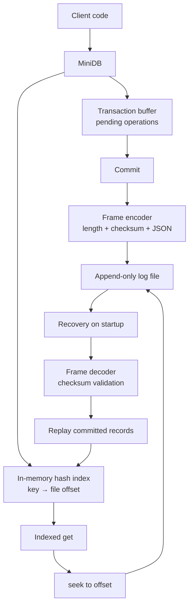
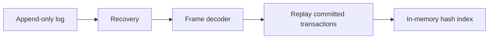

# MiniDb

A Tiny persistent key-value storage engine written in Python.

## Architecture

### Transaction Write path

### Recovery path

### Read path

## Benchmark

The full-scan benchmark uses logs containing only non-transactional `put` records. It is intended to compare indexed lookup with sequential log scanning.

Test configuration:

- Python version: 3.14
- Storage format: framed append-only log
- Durability policy: `fsync()` after each non-transactional write
- Indexed read: hash index plus `seek(offset)`
- Dataset size: 1,000 key-value pairs

### Throughput

| Operation | Result |
|---|---:|
| `put` throughput | `273.26 ops/sec` |
| Indexed `get` throughput | `40580.30 ops/sec` |
| Full-file scan throughput | `509.75 ops/sec` |

### Index memory usage

| Live keys | Estimated index memory | Estimated bytes per entry |
|---:|---:|---:|
| 100 | `10,918 bytes` | `109.18 bytes` |
| 500 | `51,446 bytes` | `102.89 bytes` |
| 1,000 | `102,922 bytes` | `102.92 bytes` |

The index memory grows approximately linearly with the number of live keys because MiniDB stores one `key → file offset` entry per live key.

## Performance notes

The hash index provides average O(1) key lookup. However, an indexed read still opens the log, seeks to the stored offset, and reads one framed record.

A full-file scan has O(n) time complexity because it reads records from the beginning of the log until it finds the latest matching value.

Big-O describes how work grows as the number of records increases. Real latency also depends on file-system calls, storage hardware, `fsync()`, and the operating system page cache.

The read benchmark performs a warm-up pass before measurement. This makes the log pages more likely to be stored in the OS page cache, so the benchmark measures warm-cache read performance rather than cold disk-read performance.